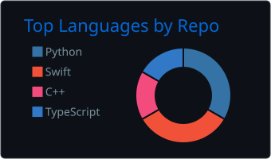
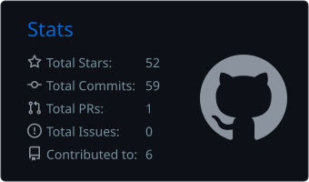

  

  
  
  

  

---

### `> whoami`

Alexander Kumar. Producer behind **IFEELVOID** — trap first, IDM textures, experimental edges.
I make the records, then build the tools and systems around them. Maryland.

### `> featured`

<table>
<tr>
<td width="50%" valign="top">

**[KeyFinder](https://github.com/ifeelvoid/keyfinder)** &nbsp;

Professional DJ key detection for macOS. Camelot keys, BPM, energy, harmonic set building.

[`repo`](https://github.com/ifeelvoid/keyfinder) · [`get it`](https://ifeelvoid.net/products/keyfinder)

</td>
<td width="50%" valign="top">

**[StackMirror](https://github.com/ifeelvoid/StackMirror)**

A local macOS app for scheduling Substack Notes, with a calendar of everything you have queued.

[`repo`](https://github.com/ifeelvoid/StackMirror)

</td>
</tr>
<tr>
<td valign="top">

**[granularverbdelay](https://github.com/ifeelvoid/granularverbdelay)**

Granular reverb / delay. C++ audio DSP.

</td>
<td valign="top">

**[producer-assistant](https://github.com/ifeelvoid/producer-assistant)**

AI assistant for music producers, built on Claude.

</td>
</tr>
</table>

### `> stack`

  

Studio: Ableton Live · DaVinci Resolve · Obsidian

### `> signal`

  
  

  

<picture>
  <source media="(prefers-color-scheme: dark)" srcset="https://raw.githubusercontent.com/ifeelvoid/ifeelvoid/output/snake-dark.svg"/>
  
</picture>

---

erase the noise.

